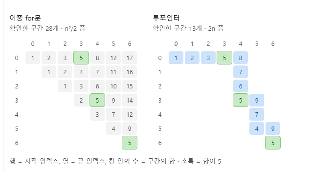

# 투 포인터

## 무엇인가

배열 위에 **인덱스 두 개**를 올려 두고, 둘을 정해진 방향으로만 움직이면서 **한 번만 훑는** 방법.

쌍이나 구간을 전부 확인하는 이중 반복(O(n²))을 **O(n)** 으로 줄인다.

## 왜 빠른가

- 포인터가 **뒤로 돌아가지 않는다.** 각자 최대 n칸 → 합쳐서 2n번 → O(n)
- 이중 반복은 "시작 × 끝" 표의 칸 n²/2 개를 전부 본다. 투 포인터는 그 표를 **계단 모양으로 한 줄만** 지나간다



[[연속된부분수열의합]] 예제 2 (`[1, 1, 1, 2, 3, 4, 5]`, `k = 5`). 행 = 시작 인덱스, 열 = 끝 인덱스, 칸 안의 수 = 구간의 합, 초록 = 합이 k.
계단이 **아래(시작을 앞으로)나 오른쪽(끝을 앞으로)으로만** 가고 위나 왼쪽으로 돌아가지 않는다. 그래서 많아야 2n칸이다.

| n | 이중 반복 (≈ n²/2) | 투 포인터 (≈ 2n) |
|---|---|---|
| 7 | 28 | 13 (실제로 센 값, [[연속된부분수열의합]] 예제 2) |
| 1,000 | 약 50만 | 약 2,000 |
| 1,000,000 | 약 5,000억 | 약 200만 |

## 건너뛰어도 되는 근거

빠른 이유는 **확인하지 않는 후보가 많아서**다. 그래서 핵심은 "왜 그 후보들은 안 봐도 되는가" 다.

- 매 단계 **둘 중 한 포인터만** 한 칸 움직인다
- 움직이는 순간 버리는 후보들이 **정답일 수 없다는 근거**가 있어야 한다
- 그 근거는 보통 **정렬되어 있다** 또는 **원소가 전부 양수다** 같은 조건에서 나온다

두 포인터를 동시에 움직이면 버리는 후보에 근거가 없어져 **정답을 건너뛸 수 있다.**

> [!warning] 근거가 되는 조건이 없으면 쓸 수 없다
> 정렬도 안 되어 있고 음수도 섞여 있으면, 구간을 늘렸는데 합이 줄 수도 있다. 그러면 어느 쪽을 움직여야 할지 정할 수 없다.
> 구간 합 문제라면 그때는 누적합 + [[해시]] 로 간다.

## 세 가지 모양

### 1. 양 끝에서 좁히기

정렬된 배열에서 합이 `target` 인 두 수 찾기.

```python
def two_sum_sorted(a, target):
    left, right = 0, len(a) - 1
    while left < right:
        s = a[left] + a[right]
        if s == target:
            return left, right
        if s < target:
            left += 1
        else:
            right -= 1
    return None
```

- `s < target`: `a[left]` 는 남은 수 중 **가장 큰 `a[right]`** 와 더해도 모자란다 → `a[left]` 가 들어간 쌍은 전부 답이 아니다 → `left` 를 버린다
- `s > target`: `a[right]` 는 남은 수 중 **가장 작은 `a[left]`** 와 더해도 넘친다 → `a[right]` 가 들어간 쌍은 전부 답이 아니다 → `right` 를 버린다

필요한 조건: **정렬.**

### 2. 같은 방향으로 — 구간

두 포인터가 둘 다 왼쪽에서 출발해 `[left, right]` 구간을 만든다.
구간의 합을 들고 다니면서, **들어오는 원소는 더하고 나가는 원소는 뺀다.** 처음부터 다시 더하지 않는다.

- 구간을 늘리면(`right` 를 앞으로) 합이 커진다
- 구간을 줄이면(`left` 를 앞으로) 합이 작아진다

필요한 조건: **원소가 전부 양수(또는 0 이상).** 그래야 "늘리면 커지고 줄이면 작아진다" 가 성립한다.

```python
def shortest_window_sum(a, k):
    best = None
    left = 0
    total = 0
    for right in range(len(a)):        # 끝을 늘린다. 범위 검사는 for 가 맡는다
        total += a[right]              # 들어온 원소를 더한다
        while total > k:               # 넘치면 시작을 줄인다
            total -= a[left]           # 나갈 원소를 먼저 빼고
            left += 1                  # 그다음 옮긴다
        if total == k and (best is None or right - left < best[1] - best[0]):
            best = (left, right)
    return best
```

- `for` 안에 `while` 이 있지만 `left` 는 전체를 통틀어 최대 n칸만 움직인다 → O(n) ([[시간복잡도]] 규칙 5)
- 합을 **들고 다닌다.** 매번 `sum(a[left:right+1])` 로 다시 더하면 O(n²) 으로 돌아간다
- 같은 길이면 먼저 찾은 것(시작이 앞인 것)이 남는다. `<` 이기 때문이다

> [!note] 슬라이딩 윈도우
> 같은 방향 투 포인터 중 **구간 길이가 고정**인 것을 보통 슬라이딩 윈도우라고 부른다. 창문을 한 칸씩 밀듯 한 원소가 들어오고 한 원소가 나간다.
> 길이가 늘었다 줄었다 하는 것도 슬라이딩 윈도우라고 부르기도 해서, 두 이름이 섞여 쓰인다.

### 3. 배열 두 개에 하나씩

배열 두 개에 포인터를 하나씩 두고, 각자 **어디까지 썼는지만** 기록하며 앞으로 간다.
정렬된 두 배열 합치기, [[카드뭉치]] 같은 문제가 이 모양이다. → [[두 뭉치 순서대로 꺼내기]]

## 주의할 점

- 인덱스로 직접 접근하므로 **범위 검사를 값 비교 앞에** 둔다 → [[IndexError - list index out of range]]
- 조건을 만족하는 후보가 여럿일 때 어느 것이 남는지는 **훑는 순서와 `<` / `<=`** 가 정한다 → [[연속된부분수열의합]]
- 반복문이 겹쳐 보여도 포인터가 앞으로만 가면 O(n) 이다. 횟수를 곱하지 말고 **포인터가 움직인 총 거리**로 센다 → [[시간복잡도]]

## 연결된 노트

- 언제 쓰는가: [[두 뭉치 순서대로 꺼내기]] · [[앞에서 빼야 할 때]]
- 교과서: [[시간복잡도]] · [[해시]]
- 관련 문제: [[연속된부분수열의합]] · [[카드뭉치]] · [[연속부분수열합의개수]]
