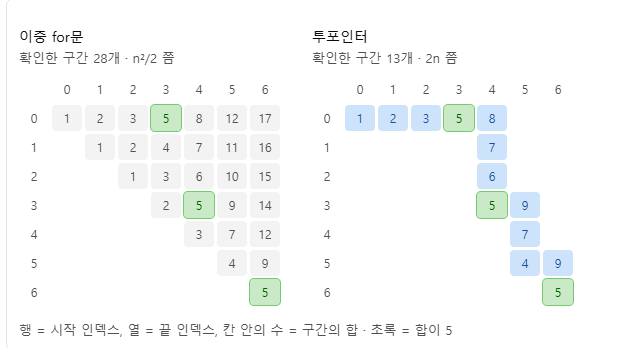

# 연속된 부분 수열의 합

- 문제: [프로그래머스 178870 - 연속된 부분 수열의 합](https://school.programmers.co.kr/learn/courses/30/lessons/178870)
- **코드: [코드/연속된부분수열의합.py](../코드/연속된부분수열의합.py)** ← 통과시킨 코드 원본
- 2026-11-24 주차 스터디 주제(투포인터)의 입문 문제

> [!info] 이 노트의 역할
> `.py` 에는 실제로 통과시킨 코드만 담백하게 둔다 (테스트 코드의 주석은 예외).
> 설명, 주석, 대안 풀이는 전부 이 노트에 적는다. 코드 파일은 기록, 노트는 회고.

## 처음 접근

투포인터 문제인 걸 모르고 먼저 풀었다. 생각한 순서:

1. 합이 k 인 연속 구간을 전부 찾는다
2. 그중 길이가 가장 짧은 것을 고른다
3. 가장 짧은 게 여러 개면 시작이 가장 앞인 것을 고른다

모든 시작점 `i` 와 길이 `j+1` 을 이중 for문으로 돌고, 구간 합은 슬라이스를 더해서 구했다.
구간을 찾을 때마다 지금까지의 답보다 짧으면 바꾸는 방식이라, 후보를 따로 모아 두지는 않았다.

1–4번은 이 이중 for문 풀이에서, 5–8번은 투포인터로 다시 짜면서 틀린 것이다.

## 무엇을 틀렸나

### 1. 길이를 `len(answer)` 로 쟀다 (1차 제출)

```python
if len(answer)>j or answer==[]:
```

0.01ms 만에 실패한 테스트가 6개 있었다 (19, 20, 21, 23, 32, 33). 시간 초과가 아니라 **오답**이다. 가장 짧은 반례:

```
sequence = [3, 5, 5, 5, 6], k = 5
기대값: [1, 1]
내 코드: [3, 3]
```

**왜 그렇게 생각했나**

<!-- len(answer) 를 쓸 때 머릿속에 있던 전제를 적을 것 -->

→ `answer` 는 `[시작, 끝]` 이라 `len(answer)` 는 **언제나 2** 다. 구간의 길이가 아니다.
그래서 `j` 가 0 이나 1 인 구간(길이 1, 2)이 나오면 지금 답이 더 짧든 같든 무조건 덮어썼다.

| 찾은 구간 | `len(answer) > j` | 결과 |
|---|---|---|
| `[1, 1]` | (`answer == []`) | 저장 |
| `[2, 2]` | `2 > 0` 참 | 덮어씀 |
| `[3, 3]` | `2 > 0` 참 | 덮어씀 |

**해결**: 구간의 길이는 `answer[1] - answer[0] + 1` 이다 → 3번.

### 2. 방패를 뒤에 뒀다 (2차, 투포인터 1차에서 또)

```python
if answer[1]-answer[0]-1>j or answer==[]:
```

`IndexError: list index out of range` (예제 1에서 바로)

**왜 그렇게 생각했나**

<!-- 적을 것 -->

→ [[카드뭉치]] 1번과 같은 실수다. `or` 도 **왼쪽부터** 계산한다. 처음엔 `answer` 가 비어 있는데, 비었는지 확인하기 전에 `answer[1]` 부터 꺼낸다.
고친 뒤에도 투포인터로 새로 짤 때 **같은 순서로 또 썼다.** 손에 익은 순서가 "비교 먼저, 예외 처리 나중" 이다.

**해결**

```python
if answer==[] or answer[1]-answer[0]>j :
```

`A or B` 에서 A 가 참이면 B 는 계산하지 않는다. **위험한 쪽을 뒤에 둔다.** → [[IndexError - list index out of range]]

### 3. 길이 비교의 `-1` (2차)

```python
answer[1]-answer[0]-1>j
```

**왜 그렇게 생각했나**

<!-- 적을 것 -->

→ 양쪽 기준이 달랐다. 숫자를 넣어 보면 바로 보인다.

- `answer = [1, 1]` (길이 1) 이면 `answer[1] - answer[0]` 은 `0`
- 지금 보는 구간이 길이 1 이면 `j` 는 `0`

둘 다 **길이 − 1** 이다. 같은 기준이니 그대로 비교하면 된다. `-1` 을 하면 기존 답을 한 칸 짧게 잰다.

**해결**: `answer[1]-answer[0]>j` (위 2번의 고친 줄)

### 4. 시간 초과 — 이중 for문

```python
def solution(sequence, k):
    answer = []
    
    def sum(seq):
        a=0
        for i in seq:
            a+=i
        return a
    
    for i in range(len(sequence)):
        for j in range(len(sequence)-i):
            if sum(sequence[i:i+j+1])==k:
                if answer==[] or answer[1]-answer[0]>j :
                    answer = [i,j+i]
            
    return answer
```

1–3번을 고친 코드. 1차 제출은 20.6점이었고, 실패한 테스트 대부분이 시간 초과였다.

**관찰**

- **답은 맞다.** 공식 예제 3개, 위 반례, 무작위 4,450건이 느린 정답 코드와 전부 같다
- 로컬에서 잰 시간 (무작위, 원소 1–1,000):

| 길이 | 시간 |
|---|---|
| 500 | 0.29s |
| 1,000 | 2.13s |
| 2,000 | 16.84s |

- 길이가 2배일 때 약 8배 → **O(n³)**. 반복이 세 겹이다
  - 시작점 `i`: n번
  - 길이 `j`: n − i 번
  - `sum(sequence[i:i+j+1])`: 슬라이스를 복사하고 처음부터 다시 더하니 최대 n번
- 수열 길이는 최대 1,000,000 이다

**이중 for문의 시간복잡도**

`i = 0` 일 때 안쪽이 n번, `i = 1` 일 때 n − 1번, …, 마지막엔 1번.

n + (n − 1) + … + 1 = **n(n + 1) / 2 ≈ n² / 2** → ½ 을 버리면 **O(n²)**

시작과 끝을 고르는 **모든 구간을 다 확인하는 모양**이 이렇다. 안쪽에서 `sum` 으로 다시 더하면 n 이 한 번 더 곱해져 O(n³).

`sum` 을 없애도 O(n²) 은 남는다. [[연속부분수열합의개수]] 에서 쓴 "앞의 합에 하나만 더하기" 로 바꿔서 재 보면:

| 길이 | 이어서 더하기 (O(n²)) |
|---|---|
| 2,000 | 0.05s |
| 4,000 | 0.21s |
| 8,000 | 0.81s |

이 추세로 길이 1,000,000 이면 약 **3.5시간**이다 (구간 약 5,000억 개). 세 겹 그대로면 수십 년.
그러니 반복 하나를 줄이는 정도로는 안 되고, **확인하는 구간 자체를 줄여야** 한다.

**왜 그렇게 생각했나**

투포인터 문제인 걸 모르고 풀었다. "가능한 것을 전부 구한 다음 고른다" 는 생각이 먼저였고, 입력 크기를 보고 목표 복잡도를 먼저 정하지 않았다 ([[시간복잡도]] 의 "입력 크기를 보고 목표 복잡도 정하기").

**해결**: 투포인터로 다시 짰다 → 5–8번을 거쳐 통과. 시간은 아래 "통과한 코드".

### 5. 반복문이 없었다 (투포인터 1차)

```python
pointer=[0,0]
if sum(sequence[pointer[0]:pointer[1]+1])<k:
    pointer=[pointer[0],pointer[1]+1]
elif ...:
    ...
return answer
```

예제 3개 모두 `[]`.

세 경우에 **어느 포인터를 움직이는지는 처음부터 맞았다.** 합 < k 면 끝을 늘리고, 합 > k 면 시작을 줄이고, 합 == k 면 기록하고 끝을 늘린다.
그런데 `if / elif` 를 **한 번만** 실행하고 바로 `return` 했다. 포인터가 한 칸 움직이고 끝난다.

**해결**: 판단 전체를 `while` 로 감쌌다.

### 6. 합을 들고 다니는데 한 칸 밀려 있었다 (투포인터 2차)

```python
pointer=[pointer[0],pointer[1]+1]      # 끝을 먼저 옮기고
total+=sequence[pointer[1]+1]          # 거기서 또 +1 → 두 칸 앞 원소를 더함
...
pointer=[pointer[0]+1,pointer[1]]      # 시작을 먼저 옮기고
total-=sequence[pointer[0]]            # 빠진 원소가 아니라 새 시작 원소를 뺌
```

매 단계 찍어 보면 `[0, 1]` 에서 이미 어긋난다 (실제 합 3, `total` 4).
`[2, 2, 2, 2, 2]` 처럼 원소가 전부 같으면 **우연히 맞게 나와서** 버그가 안 보인다.

조건문은 여전히 `sum(슬라이스)` 를 써서 `total` 을 판단에 안 썼다. 그대로면 한 단계가 O(n) 이라 다시 O(n²).

**해결**: **읽고 나서 옮긴다.** 끝을 늘릴 때 더할 건 새로 들어올 원소, 시작을 줄일 때 뺄 건 빠져나갈 원소다. 둘 다 포인터를 옮기기 **전** 인덱스로 읽는다. 조건문도 전부 `total` 로 바꿨다.

```python
total+=sequence[pointer[1]+1]
pointer=[pointer[0],pointer[1]+1]
...
total-=sequence[pointer[0]]
pointer=[pointer[0]+1,pointer[1]]
```

### 7. 멈추는 조건을 `while` 한 줄에 몰았다 (투포인터 3차)

```python
while pointer!=[len(sequence)-1,len(sequence)-1]:
```

```
[1, 1, 1, 2, 3, 4, 5], 5 -> [3, 4]       기대 [6, 6]
[2, 2, 2, 2, 2], 6       -> IndexError   기대 [0, 2]
```

두 가지가 같이 틀렸다.

- **마지막 칸을 확인하지 않고 멈춘다.** 합을 보는 건 반복 맨 위인데, `[6, 6]` 에 **도착하자마자** `while` 조건이 거짓이 되어 그 구간의 합을 못 본다
- **끝이 마지막인데도 늘리려 한다.** 시작이 아직 마지막이 아니면 `while` 조건으로 못 막고 `sequence[len]` 을 읽는다

**해결**: 끝을 늘리기 **직전에** "더 늘릴 칸이 있는가" 를 확인하고, 없으면 `break`.
끝이 마지막인데 늘려야 한다면(합 ≤ k) 남은 동작은 시작을 줄이는 것뿐이고 합은 작아지기만 한다. 그러니 거기서 멈춰도 놓치는 답이 없다.
합 == k 일 때는 **기록을 먼저** 하고 그다음 확인해야 `[6, 6]` 같은 마지막 구간도 들어간다.

### 8. 검사한 칸과 읽은 칸이 달랐다 (투포인터 4–5차)

```python
if pointer[1]<len(sequence):                 # 4 < 5 → True
    total+=sequence[pointer[1]+1]            # sequence[5] → IndexError
...
if pointer==[sequence[0],sequence[1]]:       # 4차: 인덱스를 값과 비교
if pointer==[len(sequence),len(sequence)]:   # 5차: 인덱스로는 될 수 없는 [5, 5]
```

**왜 그렇게 생각했나**

<!-- 적을 것 -->

→ 범위 검사는 **"지금 읽으려는 칸이 있는가"** 를 묻는 문지기다. 그런데:

| | 인덱스 (길이 5) | 범위 안인가 (0–4) |
|---|---|---|
| 문지기가 확인한 칸 `pointer[1]` | 4 | 예 → `True` |
| 실제로 읽은 칸 `pointer[1]+1` | 5 | **아니오** |

`pointer[1]` 은 아무리 커도 4 라서 `pointer[1] < 5` 는 **언제나 참**이다. 검사를 안 한 것과 같다. 막아야 할 순간에 "들어가도 된다" 를 냈다.

`== k` 쪽 검사는 4차에 **인덱스(몇 번째)와 값(원소)** 을 섞었고, 5차에는 인덱스끼리 비교했지만 `[len, len]` 은 인덱스로 한 번도 될 수 없는 값이라 언제나 거짓이었다.
여기서 알고 싶은 건 `< k` 쪽과 똑같이 "끝을 더 늘릴 수 있는가" 하나다.

**해결**: 읽을 인덱스를 **그대로** 검사에 넣는다. 세 곳 모두 같은 모양이 됐다.

```python
if pointer[1]+1<len(sequence):
    total+=sequence[pointer[1]+1]
```

→ `sequence[i]` 를 읽기 전 범위 검사에는 **바로 그 `i`** 를 넣는다. [[IndexError - list index out of range]]

## 통과한 코드

[코드/연속된부분수열의합.py](../코드/연속된부분수열의합.py)

- 공식 예제 3개, 1번 반례, 무작위 17,450건이 느린 정답 코드와 전부 같다
- 로컬에서 잰 시간 (무작위, 원소 1–1,000):

| 길이 | 시간 |
|---|---|
| 250,000 | 0.08s |
| 500,000 | 0.15s |
| 1,000,000 | 0.31s |

길이가 2배일 때 시간도 2배 → **O(n)**. 이중 for문의 3.5시간이 0.3초가 됐다.

## 헷갈렸던 것

### 길이가 같으면 앞쪽을 고르는 건 어디서 지켜지나

조건문은 `>` (더 짧을 때만 바꾼다) 하나뿐인데, "길이가 같으면 앞쪽" 은 어디서 지켜지는지 헷갈렸다.

→ **반복 순서**가 맡는다. 바깥 반복이 시작 인덱스 `i` 이고 0 부터 커지므로, 시작이 앞인 구간을 **먼저** 찾는다.
같은 길이가 또 나오면 `>` 가 거짓이라 바꾸지 않는다. 그래서 먼저 찾은 맨 앞 구간이 남는다.

`[2, 2, 2, 2, 2]`, `k = 6`:

| 찾는 순서 | 구간 | `answer[1]-answer[0] > j` | 결과 |
|---|---|---|---|
| 1 | `[0, 2]` | (`answer == []`) | 저장 |
| 2 | `[1, 3]` | `2 > 2` 거짓 | 유지 |
| 3 | `[2, 4]` | `2 > 2` 거짓 | 유지 |

- 더 짧으면 바꾼다 → `>` 조건
- 길이가 같으면 앞쪽 → 앞에서부터 찾고, 같으면 안 바꾼다

뒤에서부터 찾았다면 `>=` 로 덮어써야 앞쪽이 남는다. **같을 때 바꿀지는 찾는 순서가 정한다.**
투포인터도 시작이 앞으로만 가므로 똑같이 `<` (더 짧을 때만) 로 충분하다.

### 투포인터는 왜 이 문제에서 되나

원소가 전부 1 이상이라, 시작이 `i` 일 때 끝을 `r` 까지 늘려 처음으로 합이 k 이상이 됐다면:

- `i` 부터 `r − 1` 까지의 합은 k 보다 작다
- 시작을 `i + 1` 로 옮기면 양수 하나가 빠지니 `i + 1` 부터 `r − 1` 까지는 더 작다
- 그러니 시작이 `i + 1` 일 때 끝을 처음부터 다시 볼 필요 없이 **`r` 에서 이어 가면 된다**

시작과 끝이 둘 다 앞으로만 가므로 합쳐서 2n번 → O(n). 예제 2(길이 7)에서 이중 for문은 구간 28개를 보고, 투포인터는 13개만 본다.



일반적인 원리는 [[투 포인터]].

## 이렇게 했으면 어땠을까

### 1. 만약 끝 포인터를 `for` 로 돌린다면

```python
def solution(sequence, k):
    answer = [0, len(sequence)]
    left = 0
    total = 0
    for right in range(len(sequence)):
        total += sequence[right]
        while total > k:
            total -= sequence[left]
            left += 1
        if total == k and right - left < answer[1] - answer[0]:
            answer = [left, right]
    return answer
```

- 끝을 늘리는 일을 `for right in range(len(sequence))` 가 맡는다. **범위 검사를 직접 쓸 일이 없어서 7, 8번 실수가 애초에 생기지 않는다**
- `total += sequence[right]` 를 `right` 가 정해진 뒤에 하니 6번처럼 한 칸 밀릴 자리가 없다
- `answer` 를 어떤 구간보다 긴 `[0, len]` 으로 시작하면 `answer == []` 방패(2번)가 필요 없다
- `pointer` 리스트 대신 `left`, `right` 이름을 쓰면 `pointer[1]+1` 같은 인덱스가 줄어 읽기 쉽다

무작위 17,586건에서 결과가 같았고, 길이 1,000,000 에서 0.07s. 통과한 코드(0.31s)보다 빠른 건 매 단계 새 리스트 `pointer=[...]` 를 만들지 않아서다. 둘 다 O(n).

`for` 안에 `while` 이 있어 이중 반복처럼 보이지만 `left` 도 전체를 통틀어 최대 n칸만 움직이므로 O(n) 이다. → [[시간복잡도]] 규칙 5

### 2. `sum` 을 직접 만들지 않았다면

```python
def sum(seq):
    ...
```

파이썬 내장 `sum` 과 하는 일이 같고, 이름이 같아서 함수 안에서는 내장 `sum` 을 가린다. 내장 `sum(sequence[i:i+j+1])` 을 그대로 써도 결과는 같다.
어느 쪽이든 슬라이스 길이만큼 더하므로 O(n) 이다.

### 3. 통과한 코드에서 필요 없었던 것

- `while pointer!=[len(sequence),len(sequence)]` 는 한 번도 거짓이 되지 않는다. 반복은 항상 `break` 로 끝난다. `while True:` 라고 쓰는 게 실제 동작과 맞다
- `> k` 쪽의 `pointer[0]+1<len(sequence)` 검사는 없어도 된다. 시작을 줄일 때 읽는 `sequence[pointer[0]]` 는 언제나 범위 안이다

| 방식 | 시간복잡도 | 길이 1,000,000 |
|---|---|---|
| 이중 for + `sum(슬라이스)` | O(n³) | 수십 년 (추정) |
| 이중 for + 이어서 더하기 | O(n²) | 약 3.5시간 (추정) |
| 투포인터 (통과한 코드) | O(n) | 0.31s |
| 투포인터 (`for` + `while`) | O(n) | 0.07s |

## 배운 것

1. 풀기 전에 **입력 크기로 목표 복잡도부터** 정한다. 100만이면 O(n²) 도 안 된다
2. `len(리스트)` 는 원소 개수다. `[시작, 끝]` 의 구간 길이는 `끝 - 시작 + 1`
3. 비교하는 두 값이 **같은 기준**(둘 다 길이, 또는 둘 다 길이 − 1)인지 숫자를 넣어 확인한다
4. 같은 조건의 후보가 여럿일 때 어느 것이 남는지는 **찾는 순서와 `>` / `>=`** 가 정한다
5. 구간 합을 들고 다닐 때는 **읽고 나서 옮긴다.** 들어올 원소, 나갈 원소 모두 옮기기 전 인덱스
6. `sequence[i]` 를 읽기 전 범위 검사에는 **바로 그 `i`** 를 넣는다
7. 버그는 원소가 전부 같은 입력에서 숨는다. 값이 다양한 입력으로도 확인한다

## 연결된 노트

- 교과서: [[투 포인터]] · [[시간복잡도]]
- 에러: [[IndexError - list index out of range]]
- 비슷한 실수: [[카드뭉치]] · 구간 합: [[연속부분수열합의개수]]
